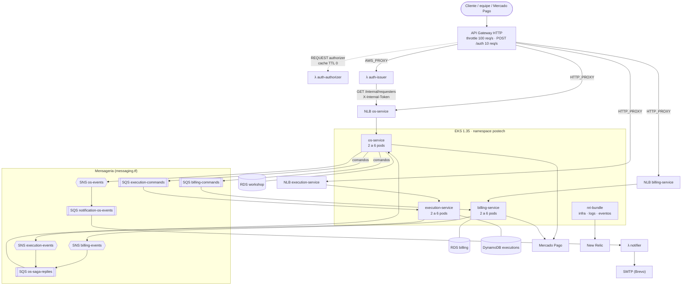
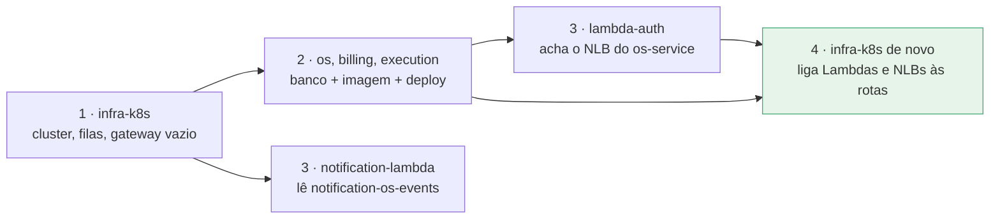

# postech-tc4-infra-k8s

Plataforma compartilhada do sistema de gestão de oficinas mecânicas, já dividido em microsserviços: **cluster EKS**, **API Gateway**, **mensageria da saga (SNS + SQS + DLQ)**, agente do New Relic e o **ambiente ponta a ponta local** com os três serviços e as duas Lambdas.

Tech Challenge Fase 4, FIAP Pós Tech SOAT.

## Onde fica cada parte

| Repositório | Conteúdo | Dados |
|---|---|---|
| **postech-tc4-infra-k8s** (este) | EKS, API Gateway, SNS/SQS/DLQ, namespace e quota, New Relic no cluster, e2e local | — |
| [postech-tc4-os-service](https://github.com/Kc1t/postech-tc4-os-service) | ordens de serviço, catálogo, clientes e veículos; **orquestrador da saga**; ADRs, RFCs e AsyncAPI | RDS Postgres `workshop` (`infra/` do repo) |
| [postech-tc4-billing-service](https://github.com/Kc1t/postech-tc4-billing-service) | orçamento e pagamento (Mercado Pago) | RDS Postgres `billing` (`infra/` do repo) |
| [postech-tc4-execution-service](https://github.com/Kc1t/postech-tc4-execution-service) | fila de diagnóstico e reparo da oficina | DynamoDB `executions` (`infra/` do repo) |
| [postech-tc4-lambda-auth](https://github.com/Kc1t/postech-tc4-lambda-auth) | Lambdas issuer (CPF → JWT) e authorizer do gateway | consulta o os-service |
| [postech-tc4-notification-lambda](https://github.com/Kc1t/postech-tc4-notification-lambda) | Lambda que manda e-mail a cada mudança de status da OS | DynamoDB de deduplicação |

Cada serviço provisiona o próprio banco (banco por serviço). Este repositório guarda só o que é compartilhado.

## Arquitetura



Toda fila tem DLQ (`<fila>-dlq`, retenção de 14 dias) e alarme no CloudWatch. As mensagens chegam às filas com raw delivery e o envelope do contrato (`pkg/contracts`, AsyncAPI no os-service).

## Estrutura

```
versions.tf, variables.tf, main.tf   providers, entradas, VPC padrão e subnets
eks.tf, iam.tf, addons.tf            cluster, node group com launch template (IMDSv2, hop 2), roles do Learner Lab,
                                     metrics-server e vpc-cni com NetworkPolicy
api_gateway.tf                       HTTP API, rotas por serviço, authorizer, throttling e access log
messaging.tf                         tópicos SNS, filas SQS, DLQs, policies, assinaturas e alarmes de DLQ
outputs.tf                           cluster, gateway, rotas, tópicos, filas e DLQs
k8s/namespace.yaml                   namespace postech com ResourceQuota e LimitRange
helm/newrelic-values.yaml            valores do nri-bundle
observability/                       dashboards, alertas, SLOs e workload do New Relic (raiz Terraform própria)
docs/runbooks/                       o que fazer quando cada alerta dispara
scripts/setup-github.sh              secrets e variáveis dos seis repositórios
local/                               ambiente ponta a ponta com docker compose e LocalStack
```

## Rotas do gateway

O gateway se liga sozinho ao que existe: as Lambdas são encontradas pelo nome e os serviços pelo NLB que o Kubernetes cria para cada `Service <serviço>-public` (tag `kubernetes.io/service-name`). Enquanto um serviço não foi publicado, as rotas dele não existem; o próximo `apply` depois do deploy as cria.

| Rota | Destino | Autenticação |
|---|---|---|
| `POST /auth` | λ auth-issuer | aberta: o CPF vira JWT (limite de 10 req/s, burst 20) |
| `POST /api/v1/auth/{proxy+}` | os-service | aberta: login e refresh da equipe |
| `GET /health` | os-service | aberta |
| `ANY /api/v1/service-orders`, `requesters`, `vehicles`, `services`, `parts` (e `/{proxy+}`) | os-service | authorizer |
| `ANY /api/v1/budgets/{proxy+}`, `ANY /api/v1/payments/{proxy+}` | billing-service | authorizer |
| `POST /api/v1/webhooks/mercadopago` | billing-service | aberta: autenticidade pela assinatura `x-signature` |
| `GET /fake-checkout/{proxy+}` | billing-service | aberta: página do gateway de pagamento fake (demo) |
| `ANY /api/v1/executions/{proxy+}` | execution-service | authorizer |

- `/internal/*` **não tem rota**: só é alcançável dentro do cluster ou pelo NLB, com `X-Internal-Token`.
- Rota protegida só é criada quando o authorizer existe; rota protegida sem authorizer seria rota aberta.
- O caminho original vai inteiro para o serviço (`overwrite:path`).
- Os serviços validam o JWT de novo e checam papel e posse (o cliente só aprova o próprio orçamento): o gateway é a primeira camada, não a única.

## Deploy

### Primeira vez

1. Kauã configura os repositórios: `scripts/setup-github.sh vars`, `app`, `newrelic`, `smtp`, `aws`, `state` e por fim `enable` (detalhes no próprio script). A cada nova sessão do Learner Lab, só `aws`.
2. A ordem entre repositórios resolve as dependências de rede e de nome:



Nenhum ARN ou DNS é copiado à mão: cada passo encontra o anterior por nome ou por tag.

### Pipeline deste repositório

| Evento | Ação |
|---|---|
| Pull Request | `fmt`, `validate`, `tfsec` e `plan` contra o state de produção |
| Push em `homolog` | o mesmo `plan`, sem `apply` (cluster único) |
| Push em `main` ou `workflow_dispatch` | `apply`, namespace e quota, `nri-bundle` do New Relic e resumo com endpoint, rotas e filas |

Os jobs com AWS só rodam com a variável `AWS_DEPLOY_ENABLED=true`: as credenciais do Learner Lab expiram a cada sessão, e sem elas o push não deve ficar vermelho.

O Learner Lab não permite criar roles IAM nem chaves KMS. Por isso o cluster usa `LabEksClusterRole` e `LabRole`, os pods herdam a `LabRole` pelo IMDS (hop limit 2 no launch template, [ADR-0016](https://github.com/Kc1t/postech-tc4-os-service/blob/main/docs/adr/0016-credenciais-dos-pods-pela-labrole.md)) e a criptografia usa chaves gerenciadas pela AWS. A AZ `use1-az3` fica de fora porque o EKS não aceita control plane nela.

## Execução local

Ponta a ponta, sem AWS: `cd local && make all` sobe os três serviços, cada um com o próprio banco, as Lambdas issuer e notifier no LocalStack e o Mailpit, e roda o caminho feliz da saga mais três compensações. Detalhes em [`local/README.md`](local/README.md).

Terraform contra uma conta:

```bash
terraform init -backend-config="bucket=<bucket-do-state>" -backend-config="key=k8s/prod.tfstate" -backend-config="region=us-east-1"
terraform plan -var-file=envs/prod.tfvars
aws eks update-kubeconfig --region us-east-1 --name postech-tc4-prod
```

## Escalabilidade e limites

- **Pods:** cada serviço tem HPA de 2 a 6 réplicas (CPU 70%, memória 80%), PodDisruptionBudget e rolling update sem indisponibilidade (manifests em `k8s/` de cada serviço).
- **Namespace:** `ResourceQuota` de 4 vCPU e 4 GiB de requests, 30 pods, e `LimitRange` com padrão por container, para um serviço com vazamento não derrubar os outros.
- **Nós:** 3 `t3.medium` (mínimo 2, máximo 5). Não há Cluster Autoscaler: o Terraform ignora o `desired_size` depois de criado e a mudança é por `aws eks update-nodegroup-config`.
- **Filas:** o consumo escala com as réplicas (cada pod faz long polling); a Lambda de notificação tem concorrência máxima de 5 no event source mapping.

## Custo

| Item | US$/hora | US$/mês 24/7 |
|---|---|---|
| Control plane do EKS | 0,100 | 73,00 |
| 3× `t3.medium` | 0,125 | 91,10 |
| 3 NLBs | 0,068 | 49,30 |
| 2× RDS `db.t3.micro` single-AZ | 0,034 | 24,80 |
| SNS, SQS, DynamoDB sob demanda, API Gateway, Lambdas | — | centavos no volume da demo |
| **Total** | **~0,33** | **~238** |

`terraform destroy` ao fim de cada sessão do lab: o control plane e os NLBs cobram por hora mesmo sem tráfego.

## Observabilidade

- No cluster: o pipeline instala o `nri-bundle` (infraestrutura, eventos do Kubernetes, `kube-state-metrics`, logs dos pods e Prometheus) quando `NEW_RELIC_LICENSE_KEY` existe.
- Dashboards, alertas com runbook, SLOs e o workload "Ordem de Serviço" ficam em [`observability/`](observability/), aplicados por um workflow próprio.
- Os alarmes de DLQ ficam no CloudWatch (`messaging.tf`), porque o Learner Lab não permite a integração da conta AWS com o New Relic. Runbook: [`docs/runbooks/dlq.md`](docs/runbooks/dlq.md).
