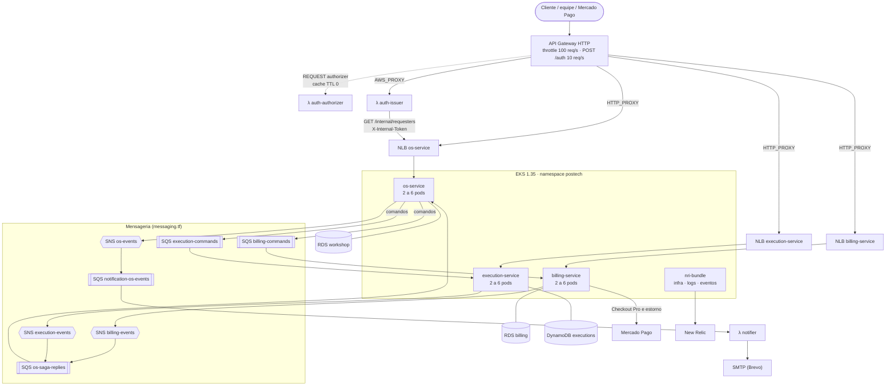
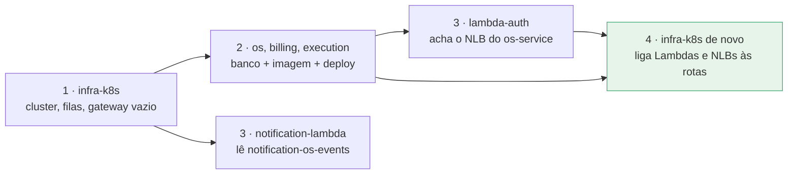

# postech-tc4-infra-k8s

Plataforma compartilhada do sistema de gestão de oficinas mecânicas, dividido em microsserviços: **cluster EKS**, **API Gateway**, **mensageria da saga (SNS + SQS + DLQ)**, **observabilidade no New Relic como código** e o **ambiente ponta a ponta local** com os três serviços e as Lambdas. É também a porta de entrada do projeto: o [guia rápido](#guia-rápido-para-avaliação) abaixo aponta onde está cada entregável nos seis repositórios.

Tech Challenge Fase 4, FIAP Pós Tech SOAT. Grupo Reservoir Devs: Kauã Miguel da Cunha, Pedro Henrique Carlini de Oliveira Ribeiro, Yuri Lopes Padlipskas e Diego Oliveira Andrade Rafael. Terraform 1.9, GitHub Actions, Helm e New Relic.

| Repositório | Papel | Banco |
|---|---|---|
| [postech-tc4-os-service](https://github.com/Kc1t/postech-tc4-os-service) | OS, clientes, veículos, catálogo e estoque; **orquestrador da saga**; ADRs, RFCs, AsyncAPI e documento de entrega | PostgreSQL `workshop` (RDS, `infra/` do repo) |
| [postech-tc4-billing-service](https://github.com/Kc1t/postech-tc4-billing-service) | orçamento e pagamento com Mercado Pago (Checkout Pro) | PostgreSQL `billing` (RDS, `infra/` do repo) |
| [postech-tc4-execution-service](https://github.com/Kc1t/postech-tc4-execution-service) | fila de diagnóstico e reparo da oficina | DynamoDB `executions` (`infra/` do repo) |
| [postech-tc4-notification-lambda](https://github.com/Kc1t/postech-tc4-notification-lambda) | e-mail ao cliente a cada mudança de status da OS | DynamoDB de deduplicação |
| [postech-tc4-lambda-auth](https://github.com/Kc1t/postech-tc4-lambda-auth) | CPF → JWT (issuer) e authorizer do API Gateway | (consulta o os-service) |
| **postech-tc4-infra-k8s** (este) | EKS, API Gateway, SNS/SQS/DLQ, namespace e quota, New Relic, e2e local, runbooks | — |

Cada serviço provisiona o próprio banco (banco por serviço, [ADR-0012](https://github.com/Kc1t/postech-tc4-os-service/blob/main/docs/adr/0012-banco-por-servico.md)). Este repositório guarda só o que é compartilhado.

## Guia rápido para avaliação

| Entregável da fase 4 | Onde está |
|---|---|
| Grupo, vídeo, endpoint do gateway e links do New Relic | [documento de entrega](https://github.com/Kc1t/postech-tc4-os-service/blob/main/docs/DOCUMENTO_ENTREGA_FASE4.md) no os-service |
| Diagrama geral da arquitetura | [Arquitetura](#arquitetura) abaixo e [`arquitetura-fase4.svg`](https://github.com/Kc1t/postech-tc4-os-service/blob/main/docs/diagrams/arquitetura-fase4.svg) no os-service |
| Divisão em microsserviços e escolha das tecnologias | [RFC-0004](https://github.com/Kc1t/postech-tc4-os-service/blob/main/docs/rfc/0004-decomposicao-em-microsservicos.md) e o [índice de ADRs](https://github.com/Kc1t/postech-tc4-os-service/blob/main/docs/adr/README.md) |
| Estratégia da saga | [ADR-0017](https://github.com/Kc1t/postech-tc4-os-service/blob/main/docs/adr/0017-saga-orquestrada-no-os-service.md) (orquestrada no os-service), [ADR-0018](https://github.com/Kc1t/postech-tc4-os-service/blob/main/docs/adr/0018-outbox-inbox-e-lock-otimista.md) (outbox e inbox) e os contratos em [AsyncAPI](https://github.com/Kc1t/postech-tc4-os-service/blob/main/docs/asyncapi/asyncapi.yaml) |
| Documentação da arquitetura de cada serviço | o README de cada repositório da tabela acima |
| Código, Dockerfile e manifestos Kubernetes | em cada repositório de serviço (`Dockerfile` e `k8s/`); a plataforma do cluster é este repositório |
| Pipelines de CI/CD | `.github/workflows/ci.yml` de cada repositório e os [pipelines deste](#pipelines-deste-repositório) |
| Evidência de cobertura | [Cobertura dos repositórios](#cobertura-dos-repositórios) |
| Swagger | `docs/swagger.yaml` no os-service, no billing e no execution, servido em `/swagger/index.html` por cada serviço. As Lambdas não servem HTTP próprio; o contrato do `POST /auth` e do authorizer está no [README da lambda-auth](https://github.com/Kc1t/postech-tc4-lambda-auth/blob/main/README.md) |
| Postman | `postman_collection.json` no os-service, no billing e no execution, com teste em toda requisição; [`make postman`](local/README.md#collections-postman-make-postman) roda as três encadeadas no fluxo da OS com newman (231 requisições, 512 asserções, 0 falhas) |
| Infraestrutura como código | este repositório (cluster, gateway, mensageria, observabilidade) e o `infra/` de cada repositório (banco, tabela e Lambdas) |
| Observabilidade e resposta a incidente | [`observability/`](observability/README.md) e [`docs/runbooks/`](docs/runbooks/) |
| Teste ponta a ponta | [`local/`](local/README.md): caminho feliz e três compensações, sem AWS |

## Cobertura dos repositórios

| Repositório | `go test` | SonarQube | Evidência |
|---|---|---|---|
| os-service | 91,9% | 92,6% | [CI](https://github.com/Kc1t/postech-tc4-os-service/actions/workflows/ci.yml) |
| billing-service | 95,8% | 96,5% | [CI](https://github.com/Kc1t/postech-tc4-billing-service/actions/workflows/ci.yml) |
| execution-service | 95,8% | 96,8% | [CI](https://github.com/Kc1t/postech-tc4-execution-service/actions/workflows/ci.yml) |
| lambda-auth | 91,4% | 92,6% | [CI](https://github.com/Kc1t/postech-tc4-lambda-auth/actions/workflows/ci.yml) |
| notification-lambda | 92,0% | 92,7% | [CI](https://github.com/Kc1t/postech-tc4-notification-lambda/actions/workflows/ci.yml) |

Os cinco pipelines reprovam abaixo de 80% e publicam no resumo de cada execução a cobertura e a tabela do SonarQube, com o quality gate aprovado (0 bugs, 0 vulnerabilidades, 0 code smells, 0% de duplicação). O detalhe de cada número está no README do repositório. Este repositório não tem código Go: o pipeline dele valida o Terraform (`fmt`, `validate`, `tfsec`), e a integração entre os serviços é verificada pelo [e2e local](local/README.md).

## Arquitetura



- **Entrada única:** todo tráfego externo passa pelo API Gateway, inclusive o webhook do Mercado Pago. O issuer troca o CPF por um JWT consultando o os-service pela rota interna; o authorizer valida o JWT antes de cada rota protegida.
- **Saga orquestrada:** o os-service envia comandos às filas `billing-commands` e `execution-commands` e recebe as respostas pela fila `os-saga-replies`, que assina os tópicos `billing-events` e `execution-events`. Toda publicação sai por outbox e todo consumo passa por inbox.
- **Notificação:** a fila `notification-os-events` assina o tópico `os-events`, e a Lambda notifier manda o e-mail.
- **Leitura composta:** o `/details` da OS chama o billing e o execution pelos Services ClusterIP de dentro do cluster ([ADR-0019](https://github.com/Kc1t/postech-tc4-os-service/blob/main/docs/adr/0019-api-composition-no-details.md)).
- **Telemetria:** os três serviços e as três Lambdas mandam APM, logs e trace ao New Relic pelo agente Go e pela extension; o `nri-bundle` cobre o cluster.

## Responsabilidades

| Faz | Não faz |
|---|---|
| Cria o cluster EKS, o node group, os addons (`metrics-server`, `vpc-cni` com NetworkPolicy) e o namespace `postech` com quota | Criar os bancos dos serviços (cada um tem o seu `infra/`) |
| Cria o API Gateway, liga as rotas aos NLBs dos serviços e às Lambdas que já existem | Criar as Lambdas (são do lambda-auth e do notification-lambda) |
| Cria tópicos, filas, DLQs, assinaturas, policies e alarmes de DLQ | Fazer o deploy dos serviços (é o job `deploy` do CI de cada um) |
| Instala o `nri-bundle` e aplica dashboard, alertas, SLOs e workload do New Relic | Instrumentar o código (agente e extension ficam em cada repositório) |
| Mantém os runbooks, o script de configuração dos seis repositórios e o e2e local | |

## Estrutura

```
versions.tf, variables.tf, main.tf   providers, entradas, VPC padrão e subnets
eks.tf, iam.tf, addons.tf            cluster, node group com launch template (IMDSv2, hop 2), roles do Learner Lab,
                                     metrics-server e vpc-cni com NetworkPolicy
api_gateway.tf                       HTTP API, rotas por serviço, authorizer, throttling e access log
messaging.tf                         tópicos SNS, filas SQS, DLQs, policies, assinaturas e alarmes de DLQ
outputs.tf                           cluster, gateway, rotas, tópicos, filas e DLQs
envs/prod.tfvars                     valores do único ambiente na AWS (staging.tfvars não é aplicado)
k8s/namespace.yaml                   namespace postech com ResourceQuota e LimitRange
helm/newrelic-values.yaml            valores do nri-bundle
observability/                       dashboard, alertas, SLOs e workload do New Relic (raiz Terraform própria)
docs/runbooks/                       o que fazer quando cada alerta dispara
scripts/setup-github.sh              secrets e variáveis dos seis repositórios
scripts/demo.sh                      roteiro da demonstração pelo gateway (caminho feliz e duas compensações)
local/                               ambiente ponta a ponta com docker compose e LocalStack
.github/workflows/                   terraform.yml (infra) e observability.yml (New Relic)
```

## Rotas do gateway

O gateway se liga sozinho ao que existe: as Lambdas são encontradas pelo nome (`postech-tc4-prod-auth-issuer` e `postech-tc4-prod-auth-authorizer`) e os serviços pelo NLB que o Kubernetes cria para cada `Service <serviço>-public` (tag `kubernetes.io/service-name=postech/<serviço>-public`). Enquanto um serviço não foi publicado, as rotas dele não existem; o próximo `apply` depois do deploy as cria.

| Rota | Destino | Autenticação |
|---|---|---|
| `POST /auth` | λ auth-issuer | aberta: o CPF vira JWT (limite de 10 req/s, burst 20) |
| `POST /api/v1/auth/{proxy+}` | os-service | aberta: login e refresh da equipe |
| `GET /health` | os-service | aberta |
| `ANY /api/v1/service-orders`, `requesters`, `vehicles`, `services`, `parts` (e `/{proxy+}`) | os-service | authorizer |
| `ANY /api/v1/budgets/{proxy+}`, `ANY /api/v1/payments/{proxy+}` | billing-service | authorizer |
| `POST /api/v1/webhooks/mercadopago` | billing-service | aberta: autenticidade pela assinatura `x-signature` |
| `GET /fake-checkout/{proxy+}` | billing-service | aberta: página do gateway de pagamento fake (demo) |
| `ANY /api/v1/executions/{proxy+}` | execution-service | authorizer |

- `/internal/*` **não tem rota**: só é alcançável dentro do cluster ou pelo NLB, com `X-Internal-Token`.
- Rota protegida só é criada quando o authorizer existe; rota protegida sem authorizer seria rota aberta.
- O caminho original vai inteiro para o serviço (`overwrite:path`), com timeout de 10 s na integração.
- Os serviços validam o JWT de novo e checam papel e posse (o cliente só aprova o próprio orçamento): o gateway é a primeira camada, não a única.

## Mensageria

| Tópico SNS | Quem publica | Fila assinante |
|---|---|---|
| `os-events` | os-service | `notification-os-events` |
| `billing-events` | billing-service | `os-saga-replies` |
| `execution-events` | execution-service | `os-saga-replies` |

| Fila SQS | Quem consome | Quem escreve | Visibilidade |
|---|---|---|---|
| `os-saga-replies` | os-service (orquestrador) | tópicos `billing-events` e `execution-events` | 30 s |
| `billing-commands` | billing-service | os-service | 30 s |
| `execution-commands` | execution-service | os-service | 30 s |
| `notification-os-events` | λ notifier | tópico `os-events` | 180 s (6× o timeout da function) |

- **Todas as filas:** long polling de 20 s, retenção de 4 dias e criptografia SSE-SQS. A policy da fila só aceita `SendMessage` dos tópicos que ela assina; os comandos o os-service envia direto, com a `LabRole`.
- **DLQ:** cada fila tem a sua `<fila>-dlq`, com retenção de 14 dias. Depois de 5 entregas sem sucesso (`max_receive_count`) a mensagem vai para a DLQ, e o redrive só é aceito de volta para a fila de origem.
- **Raw delivery** em todas as assinaturas: a fila recebe o envelope JSON do contrato (`pkg/contracts`, idêntico nos quatro repositórios Go), e os atributos da mensagem (tipo e `traceparent`) viram atributos SQS, o que mantém o trace entre os serviços.

## Segurança

- **Borda:** authorizer `REQUEST` com cache TTL 0 em todas as rotas protegidas: cada requisição é avaliada de novo, então um token expirado deixa de passar na hora. Requisição sem `Authorization` recebe 401 do próprio gateway, sem invocar o authorizer. Throttle de 100 req/s (burst 200) no stage e de 10 req/s (burst 20) no `POST /auth`, a rota exposta à enumeração de CPF.
- **Defesa em profundidade:** a integração com os serviços é `HTTP_PROXY` para NLBs públicos, sem VPC Link ([ADR-0007](https://github.com/Kc1t/postech-tc4-os-service/blob/main/docs/adr/0007-api-gateway-comunicacao.md)). Por isso cada serviço valida o JWT de novo e confere papel e posse (403), e o `/internal/*` exige `X-Internal-Token` comparado em tempo constante ([ADR-0014](https://github.com/Kc1t/postech-tc4-os-service/blob/main/docs/adr/0014-lambdas-fora-da-vpc.md)). VPC Link com NLB interno é o passo seguinte registrado na ADR-0007.
- **Nós e pods:** IMDSv2 obrigatório, com hop limit 2 para os pods herdarem a `LabRole` ([ADR-0016](https://github.com/Kc1t/postech-tc4-os-service/blob/main/docs/adr/0016-credenciais-dos-pods-pela-labrole.md)); `NetworkPolicy` efetiva pelo `vpc-cni`; `ResourceQuota` e `LimitRange` no namespace.
- **Criptografia:** filas com SSE-SQS e logs com a chave gerenciada pela AWS. O Learner Lab não permite criar chave KMS, então os tópicos SNS e os secrets do cluster ficam sem CMK; cada exceção está anotada para o `tfsec` no próprio Terraform.
- **Auditoria:** access log do gateway em `/aws/apigateway/postech-tc4-prod` (request id, IP, rota, status, latências e erro do authorizer) e logs do control plane (`api`, `audit`, `authenticator`, `controllerManager`, `scheduler`), ambos com 14 dias de retenção.
- **Segredos:** o `setup-github.sh` grava os secrets sem passar valor pela linha de comando; o CI de cada serviço cria o `Secret` do Kubernetes a partir dos GitHub Secrets.

## Observabilidade

- **Cluster:** o pipeline instala o `nri-bundle` (infraestrutura, eventos do Kubernetes, `kube-state-metrics`, logs dos pods e Prometheus) quando `NEW_RELIC_LICENSE_KEY` existe.
- **Como código:** [`observability/`](observability/README.md) cria o dashboard (Saga, Serviços, Mensageria e trace, Lambdas), 16 condições de alerta com runbook, os SLOs e o workload "Ordem de Serviço (prod)", aplicados por um workflow próprio.
- **DLQ:** o New Relic alerta pelo log `message_failed` na entrega de número 5, a última antes da DLQ, com um incidente por fila da saga; a fila da notificação é coberta pelos alertas do notifier. Além disso, o alarme `postech-tc4-prod-dlq-<fila>` do CloudWatch (`messaging.tf`) dispara com qualquer mensagem na DLQ de cada uma das quatro filas.

| Runbook | Quando usar |
|---|---|
| [servico-erros](docs/runbooks/servico-erros.md) | taxa de 5xx alta num serviço |
| [servico-latencia](docs/runbooks/servico-latencia.md) | p95 acima do limite num serviço |
| [saga-compensacao](docs/runbooks/saga-compensacao.md) | taxa de compensação da saga alta |
| [saga-expirada](docs/runbooks/saga-expirada.md) | saga encerrada por prazo |
| [dlq](docs/runbooks/dlq.md) | mensagem na última entrega ou já na DLQ |
| [mensagem-malformada](docs/runbooks/mensagem-malformada.md) | mensagem que não passa no contrato |
| [outbox-travado](docs/runbooks/outbox-travado.md) | mensagem presa no outbox |
| [lambda-erros](docs/runbooks/lambda-erros.md) | erro nas Lambdas ou falha de envio de e-mail |
| [authorizer-negacoes](docs/runbooks/authorizer-negacoes.md) | muitas requisições negadas pelo authorizer |

## Configuração dos repositórios

[`scripts/setup-github.sh`](scripts/setup-github.sh) grava os secrets e as variáveis dos seis repositórios com o `gh` CLI. Os segredos são digitados sem eco, lidos do `~/.aws/credentials` ou gerados pelo script.

| Comando | O que grava |
|---|---|
| `status` | só lista o que já está configurado em cada repositório (nomes, sem valores) |
| `vars` | `AWS_REGION` em todos; `CORS_ALLOWED_ORIGINS`, `FAULT_INJECTION_ENABLED` e `EKS_CLUSTER_NAME` nos três serviços; `PAYMENT_GATEWAY=fake` no billing; `AWS_DEPLOY_ENABLED=false` se ainda não existir |
| `app` | `JWT_SECRET` (três serviços e lambda-auth) e `INTERNAL_API_TOKEN` (os-service e lambda-auth), gerados uma vez e iguais em todos (`ROTATE=true` gera outros); `ADMIN_PASSWORD` no os-service |
| `newrelic` | `NEW_RELIC_LICENSE_KEY` em todos; `NEW_RELIC_ACCOUNT_ID` na lambda-auth, no notifier e aqui; `NEW_RELIC_API_KEY` (user key `NRAK-...`) e `NEW_RELIC_ALERT_EMAIL` só aqui |
| `smtp` | `SMTP_USERNAME`, `SMTP_PASSWORD` e `SMTP_FROM` (Brevo) no notification-lambda |
| `aws` | `AWS_ACCESS_KEY_ID`, `AWS_SECRET_ACCESS_KEY` e `AWS_SESSION_TOKEN` do Learner Lab em todos |
| `state` | cria o bucket `postech-tc4-tfstate-<conta>` (versionado, privado, criptografado) e grava `TF_STATE_BUCKET` em todos |
| `mercadopago` | `MP_ACCESS_TOKEN` e `MP_WEBHOOK_SECRET` de teste no billing e muda `PAYMENT_GATEWAY` para `mercadopago` |
| `enable` / `disable` | `AWS_DEPLOY_ENABLED=true` ou `false` em todos |

Na primeira vez: `vars`, `app`, `newrelic`, `smtp`, `aws`, `state` e `enable`. A cada nova sessão do Learner Lab, só `aws`, porque as credenciais expiram.

## Deploy

A ordem entre repositórios resolve as dependências de rede e de nome:



Nenhum ARN ou DNS é copiado à mão: cada passo encontra o anterior por nome ou por tag. O passo 4 é um *Run workflow* do `terraform.yml` depois que os serviços e as Lambdas existem.

### Pipelines deste repositório

[`terraform.yml`](.github/workflows/terraform.yml), state na chave `k8s/prod.tfstate`:

| Evento | Job | O que faz |
|---|---|---|
| Pull Request e push (`main`, `homolog`) | `Validate` | `terraform fmt -check`, `validate` e `tfsec`; é o check obrigatório da `main` |
| Pull Request e push em `homolog` | `Plan` | `plan` contra o state de produção, sem `apply`: existe um só cluster ([ADR-0021](https://github.com/Kc1t/postech-tc4-os-service/blob/main/docs/adr/0021-ambiente-unico-no-eks.md)) |
| Push em `main` ou `workflow_dispatch` | `Apply` | `apply` com `envs/prod.tfvars`, `kubectl apply -f k8s/namespace.yaml`, `nri-bundle` pelo Helm (se houver license key) e resumo do job com endpoint, rotas, filas e tópicos |

[`observability.yml`](.github/workflows/observability.yml), state na chave `observability/prod.tfstate`, disparado por PR e push que mexem em `observability/` ou por *Run workflow*:

| Evento | Job | O que faz |
|---|---|---|
| Pull Request e push na `main` | `Validate (observability)` | `fmt -check` e `validate` |
| Push na `main` ou `workflow_dispatch` | `Apply` | aplica dashboard, alertas, SLOs e workload e publica os links no resumo; exige `NEW_RELIC_ACCOUNT_ID` |

Os jobs que falam com a AWS só rodam com `AWS_DEPLOY_ENABLED=true`: as credenciais do Learner Lab expiram a cada sessão, e sem elas o push não deve ficar vermelho.

### Terraform contra uma conta

```bash
terraform init -backend-config="bucket=<bucket-do-state>" -backend-config="key=k8s/prod.tfstate" -backend-config="region=us-east-1"
terraform plan -var-file=envs/prod.tfvars
aws eks update-kubeconfig --region us-east-1 --name postech-tc4-prod
```

## Execução local

Ponta a ponta, sem AWS: `cd local && make all` sobe os três serviços, cada um com o próprio banco, as Lambdas issuer e notifier no LocalStack e o Mailpit, e roda o caminho feliz da saga mais três compensações (pagamento recusado, reparo recusado depois do pagamento e orçamento recusado pelo cliente), conferindo no fim que as quatro DLQs estão vazias. `make demo` roda o roteiro do vídeo por um gateway local. Detalhes em [`local/README.md`](local/README.md).

## Escalabilidade e limites

- **Pods:** cada serviço tem HPA de 2 a 6 réplicas (CPU 70%, memória 80%), PodDisruptionBudget e rolling update sem indisponibilidade (manifests em `k8s/` de cada serviço).
- **Namespace:** `ResourceQuota` de 4 vCPU e 4 GiB de requests (10 vCPU e 10 GiB de limits), 30 pods, e `LimitRange` com padrão por container, para um serviço com vazamento não derrubar os outros.
- **Nós:** 3 `t3.medium` (mínimo 2, máximo 5). Não há Cluster Autoscaler: o Terraform ignora o `desired_size` depois de criado e a mudança é por `aws eks update-nodegroup-config`.
- **Filas:** o consumo escala com as réplicas (cada pod faz long polling); a Lambda de notificação tem concorrência máxima de 5 no event source mapping.

## Custo

| Item | US$/hora | US$/mês 24/7 |
|---|---|---|
| Control plane do EKS | 0,100 | 73,00 |
| 3× `t3.medium` | 0,125 | 91,10 |
| 3 NLBs | 0,068 | 49,30 |
| 2× RDS `db.t3.micro` single-AZ | 0,034 | 24,80 |
| SNS, SQS, DynamoDB sob demanda, API Gateway, Lambdas | — | centavos no volume da demo |
| **Total** | **~0,33** | **~238** |

`terraform destroy` ao fim de cada sessão do lab: o control plane e os NLBs cobram por hora mesmo sem tráfego.

## Decisões e limitações

- **Um ambiente na AWS** ([ADR-0021](https://github.com/Kc1t/postech-tc4-os-service/blob/main/docs/adr/0021-ambiente-unico-no-eks.md)). O orçamento do Learner Lab comporta um cluster, então a homologação é o e2e local e o `plan` dos PRs roda contra o state de produção. O `envs/staging.tfvars` fica para um eventual segundo ambiente e não é aplicado.
- **Roles e chaves do Learner Lab.** O lab não permite criar roles IAM nem chaves KMS: o cluster usa `LabEksClusterRole` e `LabRole`, os pods herdam a `LabRole` pelo IMDS e a criptografia usa chaves gerenciadas pela AWS. O EKS é criado com recursos nativos do provider, porque o módulo `terraform-aws-modules/eks` chama `iam:GetRole`, que o lab nega.
- **Endpoint público do EKS.** Os runners do GitHub Actions rodam fora da VPC e não há NAT nem VPN neste desenho; restringir por CIDR não ajuda, porque as faixas dos runners mudam.
- **Monitoramento sem a integração do CloudWatch com o New Relic.** O lab não permite criar a role que o New Relic assume, então as métricas nativas de SQS, RDS, DynamoDB e Lambda não chegam lá. A cobertura vem da própria instrumentação (APM, spans de banco, logs de consumo e da Lambda) e dos alarmes de DLQ no CloudWatch, como detalhado em [`observability/`](observability/README.md#decisões-e-limitações).
- **AZ `use1-az3` fora do cluster**, porque o EKS não aceita control plane nela.
- **Gateway em duas passadas.** As rotas de um serviço só existem depois do deploy dele; um novo `apply` liga o que apareceu, sem ARN ou DNS em variável.
