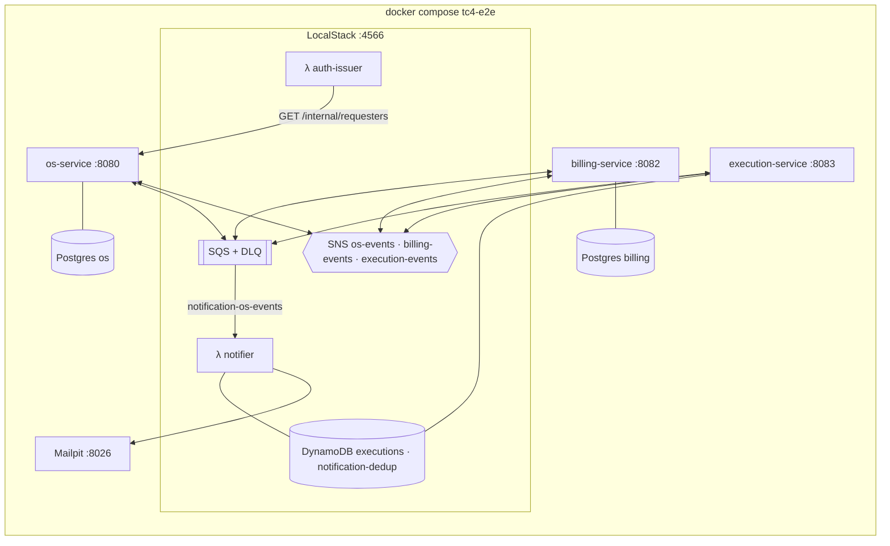

# Integração ponta a ponta (local)

Sobe a plataforma inteira na máquina, com o mesmo desenho do EKS: os três microsserviços reais, **cada um com o próprio banco**, conversando só por SNS/SQS e pela API composition. As duas Lambdas reais rodam dentro do LocalStack.



| Serviço | Porta | Observação |
|---|---|---|
| os-service | 8080 | orquestrador da saga, Postgres próprio (5433) |
| billing-service | 8082 | orçamento e pagamento com o gateway `fake`, Postgres próprio (5434) |
| execution-service | 8083 | fila do mecânico, DynamoDB `executions` |
| LocalStack | 4566 | SNS, SQS (com DLQ, maxReceiveCount 5), DynamoDB e Lambda; topologia em [`localstack/init-aws.sh`](localstack/init-aws.sh), igual à do Terraform |
| Mailpit | 8026 | caixa de entrada dos e-mails da Lambda de notificação |

## Como rodar

```bash
make up        # build das imagens a partir dos repositórios vizinhos e subida com healthcheck
make lambdas   # build linux/arm64 do issuer e do notifier e publicação no LocalStack
make e2e       # os quatro cenários abaixo
```

Requisitos: Docker, Go, `jq` e os repositórios `postech-tc4-os-service`, `-billing-service`, `-execution-service`, `-lambda-auth` e `-notification-lambda` na mesma pasta que `postech-tc4-infra-k8s`.

## O que o `e2e.sh` verifica

| Cenário | Caminho | Verificações |
|---|---|---|
| 1. Caminho feliz | abre a OS → diagnóstico pelo mecânico → orçamento → **cliente aprova com o JWT emitido pela Lambda auth-issuer** → pagamento aprovado → reparo → entrega | estoque baixou; `/details` mostra orçamento, pagamento e execução (API composition); histórico completo; **7 e-mails** no Mailpit enviados pela Lambda notifier |
| 2. Pagamento recusado | ... → pagamento `rejected` | OS e execução `cancelled`, orçamento `cancelled`, peças devolvidas ao estoque |
| 3. Reparo recusado depois do pagamento | OS aberta com `X-Simulate-Failure: repair` | pagamento `refunded` (estorno), OS `cancelled`, execução `rejected`, peças devolvidas |
| 4. Cliente recusa o orçamento | ... → `POST /budgets/{id}/reject` com o JWT do cliente | OS e execução `cancelled`, peças devolvidas |
| Filas | | as quatro DLQs vazias |

Saída de uma execução: [`e2e-sample-output.txt`](e2e-sample-output.txt).

Para seguir uma OS nos logs dos três serviços: `docker compose logs os-service billing-service execution-service | grep <os_id>`. Todas as linhas trazem o `correlation_id`, e as de mensageria também trazem o `saga_id`. Cada ação de usuário (abrir a OS, aprovar, pagar...) tem um `correlation_id` próprio, que segue nos comandos e eventos disparados por ela. O `saga_id` liga a OS inteira.
