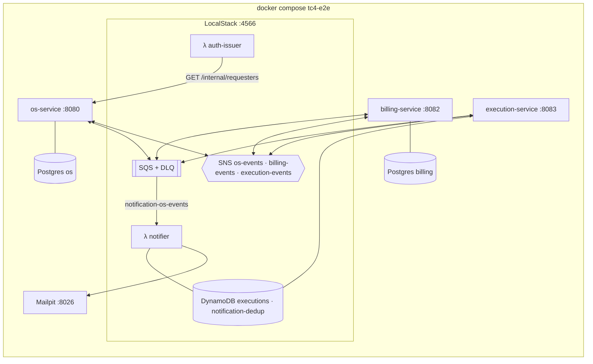

# Integração ponta a ponta (local)

Sobe a plataforma inteira na máquina, com o mesmo desenho do EKS: os três microsserviços reais, **cada um com o próprio banco**, conversando só por SNS/SQS e pela API composition. As Lambdas `auth-issuer` e `notifier` (o código real dos repositórios) rodam dentro do LocalStack; o authorizer não é publicado, porque não há API Gateway local.



| Serviço | Porta | Observação |
|---|---|---|
| os-service | 8080 | orquestrador da saga, Postgres próprio (5433) |
| billing-service | 8082 | orçamento e pagamento com o gateway `fake`, Postgres próprio (5434) |
| execution-service | 8083 | fila do mecânico, DynamoDB `executions` |
| LocalStack | 4566 | SNS, SQS (com DLQ, maxReceiveCount 5), DynamoDB e Lambda; topologia em [`localstack/init-aws.sh`](localstack/init-aws.sh), igual à do Terraform |
| Mailpit | 8026 | caixa de entrada dos e-mails da Lambda de notificação |
| Gateway local (opcional) | 8090 | nginx com as rotas do API Gateway, para o `demo.sh` (`make demo`) e as collections Postman (`make postman`) |

As portas do host mudam por variável de ambiente, se alguma já estiver ocupada: `OS_SERVICE_PORT`, `BILLING_SERVICE_PORT`, `EXECUTION_SERVICE_PORT`, `OS_POSTGRES_PORT`, `BILLING_POSTGRES_PORT`, `LOCALSTACK_PORT`, `MAILPIT_UI_PORT` e `GATEWAY_PORT`.

## Como rodar

```bash
make up        # build das imagens a partir dos repositórios vizinhos e subida com healthcheck
make lambdas   # build linux/arm64 do issuer e do notifier e publicação no LocalStack
make e2e       # os quatro cenários abaixo
make postman   # as três collections Postman com newman (seção abaixo)
```

`make all` faz `contracts`, `up`, `lambdas` e `e2e` em sequência. `make logs` acompanha os logs dos três serviços, `make down` derruba tudo (inclusive o gateway) e `make clean` também apaga os volumes e as imagens locais.

O os-service sobe com o admin padrão de desenvolvimento, `admin@workshop.com` / `admin123`, criado no bootstrap quando `ADMIN_EMAIL` e `ADMIN_PASSWORD` não estão definidos (em `APP_ENV=prod` esse padrão não existe). Os e-mails chegam em `http://localhost:8026`.

Para a demonstração do vídeo sem AWS, `make demo` (depois de `up` e `lambdas`) sobe um nginx na porta 8090 com as mesmas rotas do API Gateway, com `POST /auth` ligado à Lambda issuer por uma function URL e `/internal` sem rota, e roda o [`../scripts/demo.sh`](../scripts/demo.sh) no modo `tudo` contra ele: caminho feliz, pagamento recusado e reparo recusado depois do pagamento. O gateway local não emula o Lambda authorizer: quem barra requisição sem token são os próprios serviços, que na AWS validam o JWT de novo depois do authorizer.

`make contracts` (primeiro passo do `make all`) confere, por sha256, que o `pkg/contracts` (structs e JSON Schemas das mensagens) é idêntico no os-service, billing-service, execution-service e na Lambda de notificação; se uma cópia divergir, lista os arquivos e falha.

Requisitos: Docker, Go, `jq` e os repositórios `postech-tc4-os-service`, `-billing-service`, `-execution-service`, `-lambda-auth` e `-notification-lambda` na mesma pasta que `postech-tc4-infra-k8s`.

## O que o `e2e.sh` verifica

| Cenário | Caminho | Verificações |
|---|---|---|
| 1. Caminho feliz | abre a OS → diagnóstico pelo mecânico → orçamento → **cliente aprova com o JWT emitido pela Lambda auth-issuer** → pagamento aprovado → reparo → entrega | estoque baixou; `/details` mostra orçamento, pagamento e execução (API composition); histórico completo; **7 e-mails** no Mailpit enviados pela Lambda notifier |
| 2. Pagamento recusado | ... → pagamento `rejected` | OS e execução `cancelled`, orçamento `cancelled`, peças devolvidas ao estoque |
| 3. Reparo recusado depois do pagamento | OS aberta com `X-Simulate-Failure: repair` | pagamento `refunded` (estorno), OS `cancelled`, execução `rejected`, peças devolvidas |
| 4. Cliente recusa o orçamento | ... → `POST /budgets/{id}/reject` com o JWT do cliente | OS e execução `cancelled`, peças devolvidas |
| Filas | | as quatro DLQs vazias |

Saída de uma execução: [`e2e-sample-output.txt`](e2e-sample-output.txt).

Para seguir uma OS nos logs dos três serviços: `docker compose logs os-service billing-service execution-service | grep <os_id>`. Todas as linhas trazem o `correlation_id`, e as de mensageria também trazem o `saga_id`. Cada ação de usuário (abrir a OS, aprovar, pagar...) tem um `correlation_id` próprio, que segue nos comandos e eventos disparados por ela. O `saga_id` liga a OS inteira.

## Collections Postman (`make postman`)

`make postman` (depois de `up` e `lambdas`) roda as collections dos três serviços com newman, na imagem `postman/newman:6.1.3-alpine` (sem node local), dentro da rede do compose. As collections são intercaladas no fluxo da OS:

| Etapa | Collection | Pastas |
|---|---|---|
| 1 | os-service | health, autenticação, cadastros, token do cliente, abertura das 5 OS |
| 2 | execution-service | health e acesso, diagnóstico |
| 3 | billing-service | orçamento, decisão do cliente, pagamento simulado, webhook |
| 4 | execution-service | reparo, compensações |
| 5 | billing-service | compensações |
| 6 | os-service | entrega e consultas do cliente, compensações, limpeza |

O execution aparece duas vezes porque é o diagnóstico que dispara o orçamento. As variáveis (token, CPF, ids das OS, orçamentos e pagamentos) passam de uma etapa para outra por um environment compartilhado. As pastas que só existem para a collection rodar sozinha ficam de fora.

O script:
- sobe o gateway se ele não estiver no ar;
- imprime um resumo por etapa;
- sai com código diferente de zero se qualquer asserção falhar;
- gera CPF, placa e códigos novos a cada execução, então dá para rodar várias vezes seguidas.

Para rodar uma collection sozinha, com todas as pastas: `./postman.sh os`, `./postman.sh billing` ou `./postman.sh execution`. A variável `REPOS` aponta para outra pasta com os repositórios, se eles não estiverem ao lado deste.

Saída de uma execução: [`postman-sample-output.txt`](postman-sample-output.txt) (231 requisições, 512 asserções, 0 falhas).
